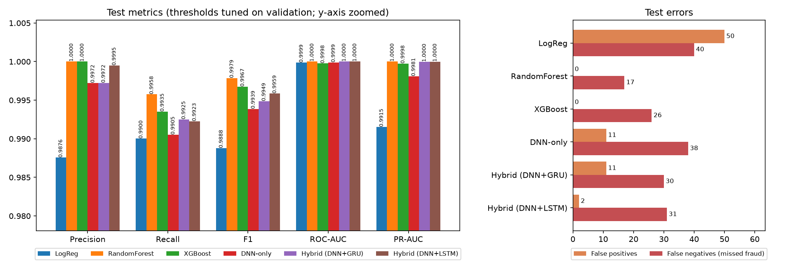

# FraudGuard: Financial Fraud Detection Using Deep Learning

Hybrid deep learning system that detects fraudulent transactions on the PaySim dataset,
with a Streamlit dashboard for live prediction and model performance.

Course project (Deep Learning, VIT Pune).

**Full documentation** (architecture, step-by-step process, problems and fixes, results with figures, app
screenshots): [docs/PROJECT_DOCUMENTATION.md](docs/PROJECT_DOCUMENTATION.md)

## Pipeline
- **Data**: PaySim (Kaggle `ealaxi/paysim1`), 6,362,620 transactions, 8,213 fraud (0.129%).
  Fraud occurs only in TRANSFER and CASH_OUT, so the models score only those 2,770,409 rows.
  `isFlaggedFraud` leaks the label and is never used.
- **Split**: chronological by `step` (70/15/15 of scored rows): train steps 1-323, validation 324-377,
  test 378-743. Scalers are fit on train only.
- **Features**: 14 per-transaction features (log amounts and balances, balance-error terms, drained/zero-balance
  flags, cyclic hour, type) plus a window of the last 5 transactions of the same `nameOrig`
  (12 features + time since each item, masked padding). Windows never cross a split boundary.
- **Model**: DNN branch (Dense 128-64-32) and GRU/LSTM branch (32 units + masked temporal attention),
  fused by attention over the two branch embeddings, sigmoid output; 21,345 trainable parameters.
- **Imbalance**: balanced class weights; decision threshold = F1-optimal point on validation;
  the test set is scored once.
- **Baselines**: LogReg, RandomForest, XGBoost and a DNN-only model on the same split and features.

## Results

Test set (steps 378-743): 408,077 transactions, 4,010 fraud. Each threshold was chosen on validation.
Confusion matrix columns follow the standard layout [[TN, FP], [FN, TP]].

| Model | Precision | Recall | F1 | ROC-AUC | PR-AUC | TN | FP | FN | TP | Train time |
|---|---|---|---|---|---|---|---|---|---|---|
| LogReg | 0.9876 | 0.9900 | 0.9888 | 0.9999 | 0.9915 | 404,017 | 50 | 40 | 3,970 | 4 s |
| RandomForest | **1.0000** | **0.9958** | **0.9979** | 1.0000 | 1.0000 | 404,067 | 0 | 17 | 3,993 | 174 s |
| XGBoost | **1.0000** | 0.9935 | 0.9967 | 0.9998 | 0.9998 | 404,067 | 0 | 26 | 3,984 | 5 s |
| DNN-only | 0.9972 | 0.9905 | 0.9939 | 0.9999 | 0.9981 | 404,056 | 11 | 38 | 3,972 | 28 s |
| Hybrid DNN+GRU | 0.9972 | 0.9925 | 0.9949 | 1.0000 | 1.0000 | 404,056 | 11 | 30 | 3,980 | 226 s |
| Hybrid DNN+LSTM | 0.9995 | 0.9923 | 0.9959 | 1.0000 | 1.0000 | 404,065 | 2 | 31 | 3,979 | 226 s |

Train times are on CPU (16 threads); TensorFlow has no GPU support on native Windows.



Figures are written to `reports/figures/` by `src.eda` and `src.evaluate` (generated, not tracked;
copies used by the documentation live in `docs/images/`):
`model_comparison.png` (metrics plus FP/FN counts per model), `class_distribution.png`,
`fraud_over_time.png`, `amount_distribution.png`, `training_curves.png`, `roc_pr_curves.png`,
`confusion_matrix_*.png`, `architecture.png`.

### Findings
- **The hybrid beats the DNN-only model** (F1 0.9949 vs 0.9939, 30 vs 38 missed frauds; the LSTM variant also
  cuts false positives from 11 to 2), but **tree ensembles are best overall**. RandomForest has the highest F1
  with zero false positives.
- **PaySim is close to separable from balance columns.** In 98% of fraud the amount equals the origin's full
  balance (the account is drained), versus 0.0% of legit transactions. Every model therefore scores above 0.98,
  and the differences come down to a few dozen transactions.
- **Per-user history is almost empty in PaySim.** Only 9,298 of 6.35M `nameOrig` accounts have more than one
  transaction (maximum 3). The hybrid learns to put about 10% of its fusion weight on the history branch
  (3% on fraud rows), so its gain over DNN-only comes mostly from extra capacity, not from sequences.
  The recurrent branch would matter more on data with real account histories.
- **Prevalence shifts over time**: legit volume drops after step ~400 while fraud stays flat, so test fraud
  prevalence (0.98%) is about 5x train (0.19%). The chronological split keeps this realistic shift in the test set.

## Setup
```bash
python -m venv .venv
.venv/Scripts/pip install -r requirements.txt   # Windows; use .venv/bin/pip on Linux/macOS
```
Place the PaySim CSV at `data/raw/paysim.csv` (not tracked by git).

## Reproduce
```bash
python -m src.eda                 # Stage 1: EDA stats and figures
python -m src.prepare             # Stage 2: features + sequences (add --dev for the sample)
python -m src.baselines           # Stage 3: LogReg, RF, XGBoost, DNN-only (validation only)
python -m src.train --rnn gru     # Stage 4: hybrid model (also --rnn lstm)
python -m src.evaluate            # Stage 5: single test evaluation + figures
streamlit run app/streamlit_app.py
python -m pytest -q
```
All randomness uses seed 42. `src.evaluate` refuses to score the test set twice unless given `--force`.

## App
- **Dashboard**: dataset stats, test-period alerts per hour, highest-risk transactions.
- **Predict Transaction**: score a TRANSFER/CASH_OUT (optionally with the account's earlier transactions);
  shows probability, decision, and fusion and temporal attention weights. Can load real test examples.
- **Model Performance**: test metrics for all models, confusion matrices, ROC/PR, training curves, architecture.
