# FraudGuard: Financial Fraud Detection Using Deep Learning

**Project documentation**
Course project, Deep Learning, VIT Pune
Repository: https://github.com/dhruv-karanwal/FraudGuard

---

## Contents
1. [Abstract](#1-abstract)
2. [Problem statement and objectives](#2-problem-statement-and-objectives)
3. [Dataset](#3-dataset)
4. [System architecture](#4-system-architecture)
5. [How we proceeded: stage by stage](#5-how-we-proceeded-stage-by-stage)
6. [Problems we faced and how we solved them](#6-problems-we-faced-and-how-we-solved-them)
7. [Hybrid model architecture](#7-hybrid-model-architecture)
8. [Training setup](#8-training-setup)
9. [Results](#9-results)
10. [Discussion](#10-discussion)
11. [Streamlit application](#11-streamlit-application)
12. [Testing and quality checks](#12-testing-and-quality-checks)
13. [Version control workflow](#13-version-control-workflow)
14. [Limitations and future work](#14-limitations-and-future-work)
15. [How to reproduce](#15-how-to-reproduce)
16. [References](#16-references)

---

## 1. Abstract

FraudGuard detects fraudulent mobile-money transactions in the PaySim dataset (6.36 million transactions,
0.129% fraud). The core model is a **hybrid deep network**. A fully connected (DNN) branch encodes the
current transaction, and a recurrent (GRU or LSTM) branch encodes the account's recent transaction history.
An attention layer fuses the two branches into one fraud probability. The data is split chronologically,
class imbalance is handled with class weights, the decision threshold is tuned on validation data, and
the test set is scored exactly once. We compared the hybrid against Logistic Regression, Random Forest,
XGBoost and a DNN-only network on the same split.

On the held-out test period (408,077 transactions, 4,010 fraud) the hybrid DNN+LSTM reaches
**F1 = 0.9959, precision = 0.9995, recall = 0.9923 and PR-AUC = 1.0000**. It beats the DNN-only network and
Logistic Regression, while Random Forest is best overall (F1 = 0.9979). A Streamlit dashboard serves the
model for live scoring and shows the attention weights behind each decision.

## 2. Problem statement and objectives

Financial fraud is rare, costly and hard to catch: a model must find a handful of fraudulent transactions
among millions of legitimate ones without raising too many false alarms. Accuracy alone is meaningless here,
since predicting "legit" for every transaction already gives 99.87% accuracy.

**Objectives**
1. Build an end-to-end pipeline on PaySim: loading, exploration, feature engineering and sequence building.
2. Design a hybrid deep learning model that combines per-transaction features with per-account history,
   fused by attention.
3. Handle the extreme class imbalance properly (class weights, threshold tuning, PR-AUC).
4. Evaluate honestly: chronological split, no leakage, test set used once.
5. Compare against classical and deep baselines on the same split.
6. Deliver a usable Streamlit application for monitoring and live prediction.

## 3. Dataset

PaySim is a synthetic dataset generated from one month of real mobile-money logs from an African country.
Each row is one transaction; `step` is the simulation hour (1 to 743).

| Column | Meaning |
|---|---|
| `step` | hour of the simulation (1-743) |
| `type` | CASH_IN, CASH_OUT, DEBIT, PAYMENT, TRANSFER |
| `amount` | transaction amount |
| `nameOrig`, `nameDest` | origin and destination account IDs |
| `oldbalanceOrg`, `newbalanceOrig` | origin balance before and after |
| `oldbalanceDest`, `newbalanceDest` | destination balance before and after |
| `isFraud` | label |
| `isFlaggedFraud` | simulator's rule-based flag (**leaks the label, never used as a feature**) |

**Key facts from our exploratory analysis**

| Fact | Value |
|---|---|
| Transactions | 6,362,620 |
| Fraud transactions | 8,213 (0.129%) |
| Missing values | 0 |
| Fraud by type | TRANSFER 4,097, CASH_OUT 4,116, all other types 0 |
| `isFlaggedFraud` | flags 16 rows, all fraud |
| Unique `nameOrig` | 6,353,307; only 9,298 appear more than once (max 3 times) |

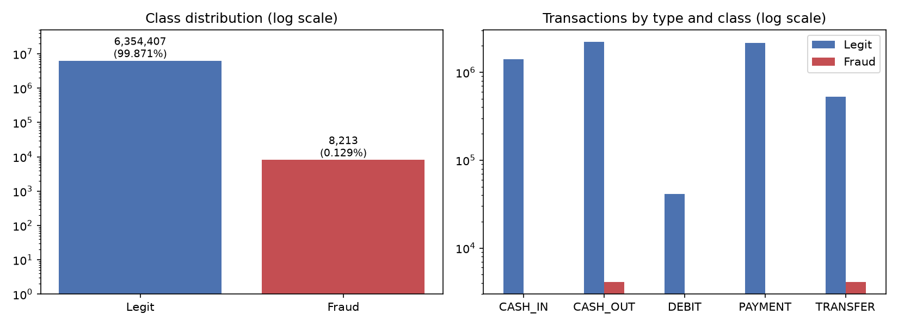
*Figure 1. Class distribution (log scale) and transactions by type. Fraud appears only in TRANSFER and CASH_OUT.*

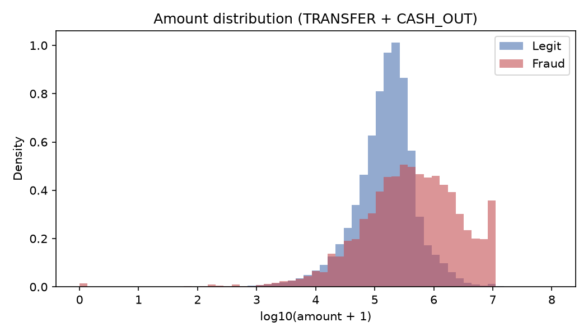
*Figure 2. Amount distribution for TRANSFER and CASH_OUT. Fraud amounts are shifted higher.*

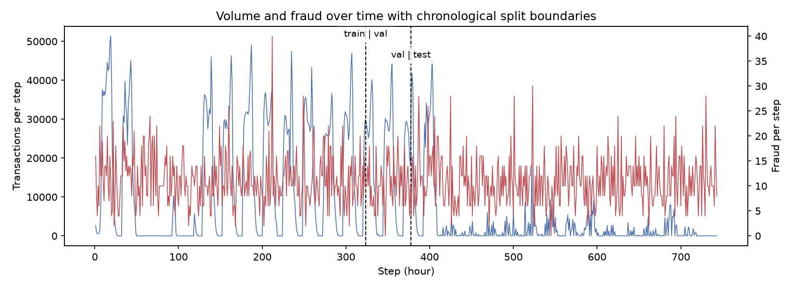
*Figure 3. Transactions per hour (blue) and fraud per hour (red), with our split boundaries. Legitimate volume
collapses after about step 400 while fraud stays flat.*

## 4. System architecture

The system has five layers: data, processing, modelling, evaluation and serving. Each layer is a separate
Python module, and the layers communicate only through files on disk, so any stage can be re-run on its own.

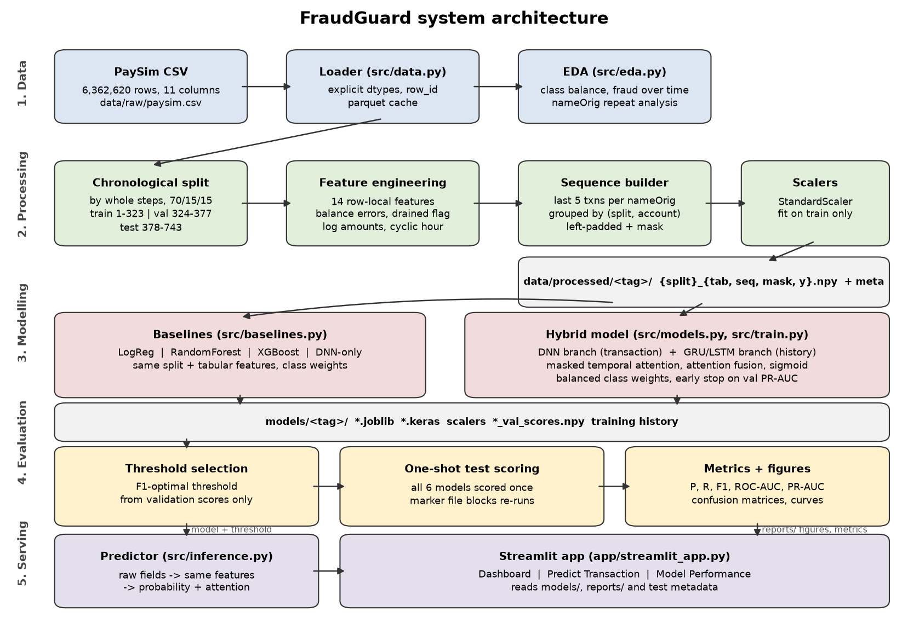
*Figure 4. FraudGuard system architecture.*

**How it works, end to end**

1. **Data layer.** `src/data.py` reads the 494 MB CSV with explicit data types, adds a `row_id` that keeps the
   original order within each hour, and caches the result as parquet, so later loads take about 2 seconds
   instead of a full CSV parse. `src/eda.py` produces the statistics and figures in Section 3.
2. **Processing layer.**
   - *Chronological split*: rows are sorted by (`step`, `row_id`) and cut on whole hours into
     70% / 15% / 15% of the scored rows. Training data always comes before validation, and validation before test.
   - *Feature engineering* (`src/features.py`): 14 features computed from the row alone, so nothing leaks
     from other rows.
   - *Sequence builder* (`src/sequences.py`): for every transaction, the last 5 transactions of the same
     `nameOrig` (current one last), left-padded with a mask. Windows are grouped by (split, account), so they
     never cross a split boundary and never include a later transaction.
   - *Scalers*: StandardScaler fit on training rows only, then applied to validation and test.
3. **Modelling layer.** Four baselines (`src/baselines.py`) and the hybrid model (`src/models.py`,
   `src/train.py`) train on the same arrays. Each model stores its validation scores.
4. **Evaluation layer.** `src/evaluate.py` picks each model's threshold from its validation scores, scores the
   test set once for all models, and writes metrics and figures. A marker file prevents the test set from
   being scored a second time by accident.
5. **Serving layer.** `src/inference.py` turns raw transaction fields into exactly the same features as the
   batch pipeline, and the FraudGuard console (`app/`) serves analysts (Section 11).

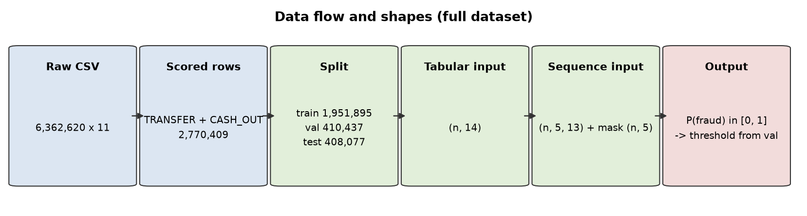
*Figure 5. Data flow and array shapes on the full dataset.*

**Repository layout**

```
FraudGuard/
├── src/
│   ├── config.py        paths, seed (42), split fractions, sequence length
│   ├── data.py          loading, dev sample, chronological split
│   ├── eda.py           exploratory analysis + figures
│   ├── features.py      feature engineering + train-only scaler
│   ├── sequences.py     per-account history windows
│   ├── prepare.py       builds model-ready arrays per split
│   ├── metrics.py       shared metrics + validation threshold
│   ├── models.py        DNN-only and hybrid Keras models
│   ├── training.py      seeding + shared Keras training loop
│   ├── baselines.py     LogReg, RandomForest, XGBoost, DNN-only
│   ├── train.py         hybrid model training
│   ├── evaluate.py      one-shot test evaluation + figures
│   └── inference.py     single-transaction predictor for the app
├── app/
│   ├── streamlit_app.py app shell: theme, navigation, status bar
│   ├── core.py          decision tiers, risk signals, money metrics, cost curve, cases
│   └── views/           overview, alerts, investigate, live, check, model pages
├── tests/               31 pytest tests
├── docs/                this document, diagrams, images
├── data/raw/            PaySim CSV (not tracked)
├── models/              trained models (not tracked)
└── reports/figures/     generated figures (not tracked)
```

## 5. How we proceeded: stage by stage

We worked in **nested loops**. The outer loop goes through seven stages in order. Inside each stage we
looped *implement → run → check → fix* until every check passed (tests, metrics, sanity checks). Only then
did we commit and move on. We never moved to the next stage while a check was failing.

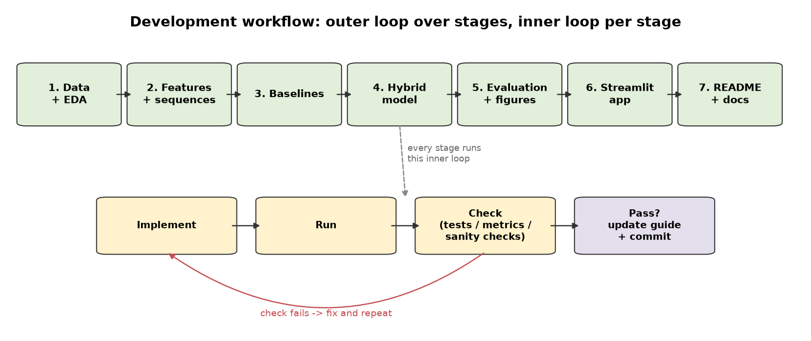
*Figure 6. Outer loop over stages, inner loop inside each stage.*

### Stage 1: Data loading and EDA
- **Did:** wrote the loader with a parquet cache, the chronological split, the development sample (all fraud
  rows plus every 10th legitimate row, kept in time order) and the EDA script.
- **Checked:** unit tests that the splits are disjoint, time-ordered, on whole hours and close to 70/15/15,
  and that the dev sample keeps every fraud row.
- **Found:** fraud only in TRANSFER/CASH_OUT; `isFlaggedFraud` leaks the label; `nameOrig` almost never
  repeats; fraud prevalence rises over time.
- **Result:** train = steps 1-323 (1,951,895 scored rows, 3,643 fraud), validation = 324-377 (410,437 rows,
  560 fraud), test = 378-743 (408,077 rows, 4,010 fraud).

### Stage 2: Features and sequence builder
- **Did:** built 14 tabular features and 12 sequence features (plus a "hours since" channel), the history
  window builder, and `prepare.py`, which writes `.npy` arrays for each split.
- **Checked:** tests pin exact feature values, assert that neither the label nor `isFlaggedFraud` is a feature,
  check that the scaler uses training statistics only, and check window contents, padding, masking and that
  no window crosses a split. Sanity checks: every array is finite, and training features have mean 0 and std 1.
- **Result:** the full dataset prepares in about 15 seconds. Only 2,028 of 1,951,895 training rows have any
  earlier transaction from the same account.

**Engineered features (DNN branch)**

| Feature | Definition | Why |
|---|---|---|
| `log_amount` | log(1 + amount) | amounts span 7 orders of magnitude |
| `log_oldbalanceOrg`, `log_newbalanceOrig` | log balances of origin | scale |
| `log_oldbalanceDest`, `log_newbalanceDest` | log balances of destination | scale |
| `err_balance_orig` | signed log of (newOrig + amount − oldOrig) | bookkeeping mismatch at origin |
| `err_balance_dest` | signed log of (oldDest + amount − newDest) | bookkeeping mismatch at destination |
| `amount_to_balance` | log(1 + amount / (oldOrig + 1)) | share of the balance moved |
| `orig_zero_before` | oldOrig = 0 | empty account |
| `orig_emptied` | newOrig = 0 and oldOrig > 0 | account drained |
| `dest_zero_both` | destination balance 0 before and after | untouched destination |
| `hour_sin`, `hour_cos` | cyclic encoding of step mod 24 | time of day |
| `type_TRANSFER` | 1 for TRANSFER, 0 for CASH_OUT | transaction type |

### Stage 3: Baselines
- **Did:** trained Logistic Regression, Random Forest, XGBoost and a DNN-only network on the same split and
  features, each with class weighting.
- **Checked:** metric tests (confusion-matrix layout, threshold selection, class weights) and validation metrics.
- **Found:** on the development sample every model scored a perfect F1 = 1.0. We investigated before going
  further (see Problem 4 in Section 6).
- **Result (validation, full data):** LogReg F1 0.927, Random Forest 1.000, XGBoost 1.000, DNN-only 0.996.

### Stage 4: Hybrid model
- **Did:** built the DNN + GRU/LSTM model with masked temporal attention and attention fusion, trained it on
  the development sample first and then on the full data (GRU and LSTM variants).
- **Checked:** model tests: outputs are valid probabilities, padded history slots cannot change the prediction,
  attention weights sum to 1, and a saved model reloads with identical outputs. We also measured how much the
  model actually uses the history branch.
- **Result (validation):** GRU F1 0.9982 (1 FP, 1 FN), LSTM F1 0.9991 (0 FP, 1 FN). Training took about
  4 minutes per model on CPU.

### Stage 5: Evaluation and figures
- **Did:** selected each threshold on validation, scored the test set once for all six models, and generated
  the comparison, confusion-matrix, ROC/PR, training-curve and architecture figures.
- **Checked:** ran the whole evaluation on the development sample first, so a bug in the plotting code could not
  force a second test-set run on the full data. Every figure was inspected by eye.
- **Result:** the test metrics in Section 9.

### Stage 6: Streamlit application
- **Did:** first a three-page analysis app, then rebuilt it as a six-page fraud-operations console
  (Section 11) on top of a `Predictor` class.
- **Checked:** a test that single-transaction scoring matches the batch pipeline to 1e-5, headless tests that
  every page renders without errors, and manual checks in a browser.
- **Result:** Section 11.

### Stage 7: Documentation
- **Did:** wrote the README results section and this document.

## 6. Problems we faced and how we solved them

| # | Problem | How we noticed | What we did |
|---|---|---|---|
| 1 | **Label leakage through `isFlaggedFraud`** | EDA: all 16 flagged rows are fraud | Excluded the column from all features; a test asserts it never appears. |
| 2 | **Extreme class imbalance** (0.19% fraud in training) | EDA | Balanced class weights (fraud weight ≈ 268, legit ≈ 0.5); F1-optimal threshold tuned on validation; PR-AUC reported alongside ROC-AUC. |
| 3 | **Slow loading of the 494 MB CSV** | every run re-parsed it | Parquet cache with explicit dtypes; full preparation now takes about 15 s. |
| 4 | **Every model scored a perfect 1.0 on the development sample** | Stage 3 validation | Investigated before trusting it. In 98% of fraud the amount equals the origin's full balance (the account is drained), versus 0.0% of legitimate transactions. This is how PaySim simulates fraud, not a bug or leak: the features are observable at transaction time. The dev sample is even easier because legitimate rows are subsampled 10×, so we moved to the full data for real numbers. |
| 5 | **Per-user history is nearly empty** | EDA: only 9,298 of 6.35M accounts repeat | Kept the specified design (sequences per `nameOrig`) but measured it: the model puts only about 10% of its fusion weight on the history branch (3% on fraud rows). Reported honestly; see Section 14 for the fix. |
| 6 | **Fraud prevalence shifts over time** (test ≈ 5× train) | fraud-over-time plot | Kept the chronological split (it reflects deployment) and tuned the threshold on validation, never on test. |
| 7 | **Risk of leakage through sequences** | design review | Windows are grouped by (split, account) and include only past rows; dedicated tests check this. |
| 8 | **Risk of touching the test set more than once** | evaluation design | Thresholds come only from saved validation scores; a marker file blocks a second test run; figures can be redrawn from saved scores without re-scoring. |
| 9 | **Padded history slots could leak into predictions** | model design | Explicit mask input to the GRU and to the attention layer; a test fills padded slots with garbage and asserts the output is unchanged. |
| 10 | **Model could not be saved and reloaded** | Keras warnings | Replaced a Python `Lambda` layer with a registered custom layer, and gave the custom attention layers proper `build()` methods. Save/load is now covered by a test. |
| 11 | **No GPU for TensorFlow on native Windows** | TensorFlow warning | Kept the model small (21,345 trainable parameters) and used batch size 2,048; each hybrid trains in about 4 minutes on a 16-thread CPU. |
| 12 | **Keras PR-AUC disagreed with scikit-learn** (≈0.995 vs 0.99999) | training logs | Keras approximates AUC with 200 thresholds. We used Keras PR-AUC only for early stopping and report the exact scikit-learn values. |
| 13 | **Charts could not tell the models apart** (all > 0.98) | first version of the figures | Zoomed the axes and added a false-positive / false-negative count panel, which shows the real differences. |
| 14 | **App inference could drift from training features** | design review | The app reuses the same feature and sequence code; a test checks single-row features and scores against the prepared arrays. |
| 15 | **App display issues** | browser checks | Shortened metric values that were cut off, replaced a deprecated Streamlit argument, and fixed a table highlight that was unreadable in dark mode. |
| 16 | **Cost-optimal threshold looked worse than the deployed one** | console check: the "optimum" cost more than the current threshold | The first version searched a coarse grid of thresholds and skipped the best values. Replaced it with an exact sweep (sort scores once, cumulative sums), now tested against a direct calculation. |
| 17 | **Blank or half-rendered screenshots** | headless Chrome captured pages before Streamlit finished | Streamlit renders over a websocket after page load, so we drive Chrome through its DevTools protocol and wait in real time (`docs/capture_screens.py`). |
| 18 | **Misleading colours** | design review | High-risk bars were green and "money protected" showed a red arrow when less fraud occurred; risk is now red, neutral changes are grey, and every colour also has a text label. |

## 7. Hybrid model architecture

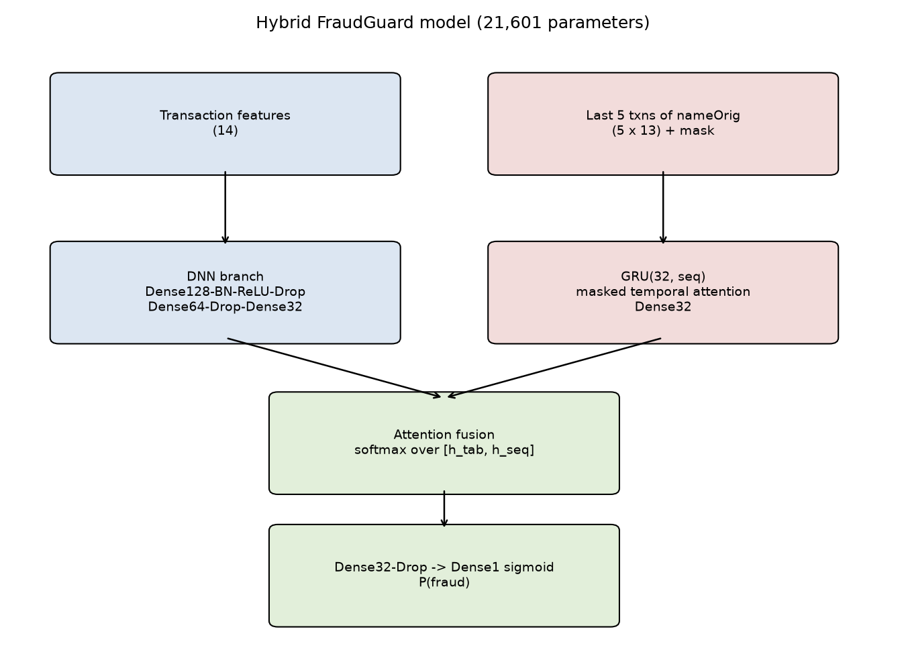
*Figure 7. Hybrid model: DNN branch for the current transaction, GRU branch for account history, attention fusion.*

**Branches**
- **DNN branch** (14 inputs): Dense 128 → BatchNorm → ReLU → Dropout 0.2 → Dense 64 (ReLU) → Dropout 0.2 →
  Dense 32 (ReLU) gives the transaction embedding `h_tab`.
- **Recurrent branch** (5 × 13 inputs + mask): GRU (or LSTM) with 32 units over the window → **masked temporal
  attention** (additive attention; padded steps get weight 0) → Dense 32 gives the history embedding `h_seq`.
- **Attention fusion**: the two embeddings are stacked, each is scored by a small tanh layer, and a softmax
  gives two weights that sum to 1. The fused vector is the weighted sum. These weights are shown in the app,
  so a user can see whether a decision was driven by the transaction or by the history.
- **Head**: Dense 32 (ReLU) → Dropout 0.2 → Dense 1 (sigmoid) gives P(fraud).

| Layer | Output shape | Parameters |
|---|---|---|
| tab (input) | (14) | 0 |
| tab_dense1 + BatchNorm | (128) | 1,920 + 512 |
| tab_dense2 | (64) | 8,256 |
| tab_embed | (32) | 2,080 |
| seq (input) + mask | (5, 13) + (5) | 0 |
| seq_gru | (5, 32) | 4,512 |
| time_attention | (32), weights (5) | 1,088 |
| seq_embed | (32) | 1,056 |
| fusion_attention | (32), weights (2) | 1,088 |
| head_dense | (32) | 1,056 |
| fraud (sigmoid) | (1) | 33 |
| **Total trainable** | | **21,345** |

## 8. Training setup

| Setting | Value |
|---|---|
| Random seed | 42 (Python, NumPy, TensorFlow, scikit-learn, XGBoost) |
| Loss | binary cross-entropy with balanced class weights (fraud ≈ 268, legit ≈ 0.50) |
| Optimiser | Adam, learning rate 1e-3, halved after 2 epochs without improvement (minimum 1e-5) |
| Batch size | 2,048 |
| Epochs | up to 30, early stopping on validation PR-AUC (patience 5, best weights restored) |
| Epochs actually run | DNN-only 6, hybrid GRU 14, hybrid LSTM 15 |
| Dropout | 0.2 |
| Threshold | F1-optimal on validation (GRU 0.9989, LSTM 0.9998) |
| Logistic Regression | class_weight balanced, max_iter 2000 |
| Random Forest | 200 trees, min_samples_leaf 2, class_weight balanced_subsample |
| XGBoost | up to 600 trees, depth 6, learning rate 0.1, subsample 0.9, scale_pos_weight = neg/pos, early stopping on validation PR-AUC |
| Hardware | 16-thread CPU, 16 GB RAM (TensorFlow has no GPU support on native Windows) |

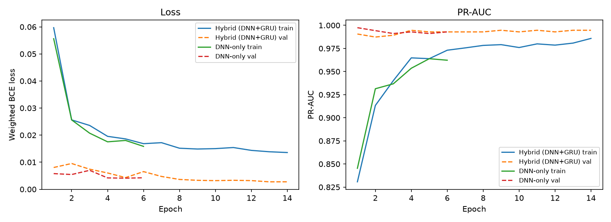
*Figure 8. Training and validation loss and PR-AUC for the hybrid GRU and DNN-only models. Validation loss
sits below training loss because training loss is class-weighted and uses dropout.*

## 9. Results

### 9.1 Test-set metrics

Test period: steps 378-743, 408,077 transactions, 4,010 fraud. Each threshold was chosen on validation, and
the test set was scored once. Confusion matrix layout: [[TN, FP], [FN, TP]].

| Model | Precision | Recall | F1 | ROC-AUC | PR-AUC | TN | FP | FN | TP |
|---|---|---|---|---|---|---|---|---|---|
| Logistic Regression | 0.9876 | 0.9900 | 0.9888 | 0.9999 | 0.9915 | 404,017 | 50 | 40 | 3,970 |
| Random Forest | **1.0000** | **0.9958** | **0.9979** | 1.0000 | 1.0000 | 404,067 | 0 | 17 | 3,993 |
| XGBoost | **1.0000** | 0.9935 | 0.9967 | 0.9998 | 0.9998 | 404,067 | 0 | 26 | 3,984 |
| DNN-only | 0.9972 | 0.9905 | 0.9939 | 0.9999 | 0.9981 | 404,056 | 11 | 38 | 3,972 |
| Hybrid DNN+GRU | 0.9972 | 0.9925 | 0.9949 | 1.0000 | 1.0000 | 404,056 | 11 | 30 | 3,980 |
| Hybrid DNN+LSTM | 0.9995 | 0.9923 | 0.9959 | 1.0000 | 1.0000 | 404,065 | 2 | 31 | 3,979 |

### 9.2 Validation metrics (for reference)

| Model | F1 | PR-AUC | FP | FN |
|---|---|---|---|---|
| Logistic Regression | 0.9274 | 0.9194 | 83 | 4 |
| Random Forest | 1.0000 | 1.0000 | 0 | 0 |
| XGBoost | 1.0000 | 1.0000 | 0 | 0 |
| DNN-only | 0.9955 | 0.9992 | 3 | 2 |
| Hybrid DNN+GRU | 0.9982 | 1.0000 | 1 | 1 |
| Hybrid DNN+LSTM | 0.9991 | 1.0000 | 0 | 1 |

### 9.3 Figures

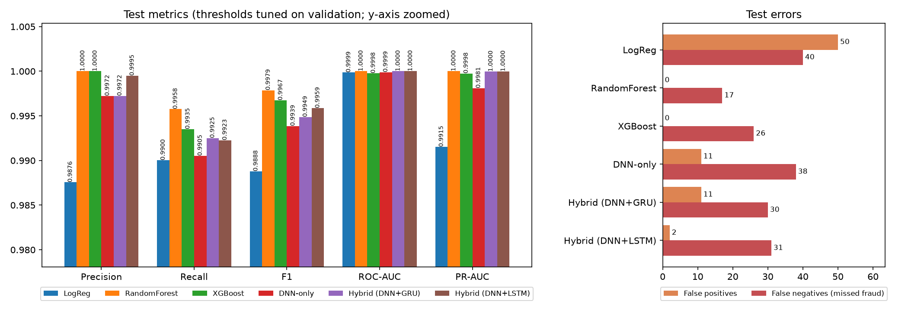
*Figure 9. Test metrics (y-axis zoomed) and false-positive / false-negative counts per model.*

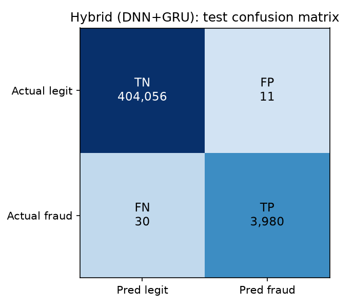
*Figure 10. Confusion matrix of the hybrid DNN+GRU on the test set.*

| | |
|---|---|
| 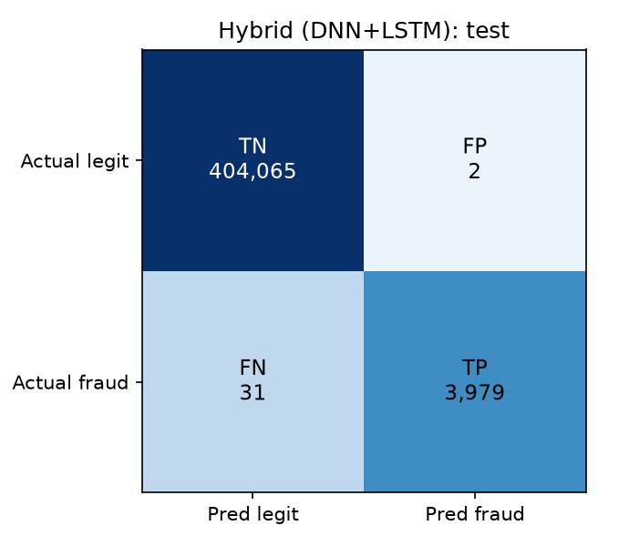 | 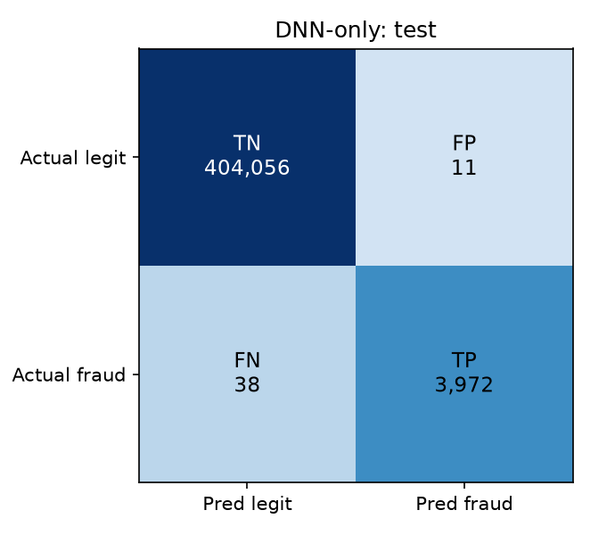 |
| 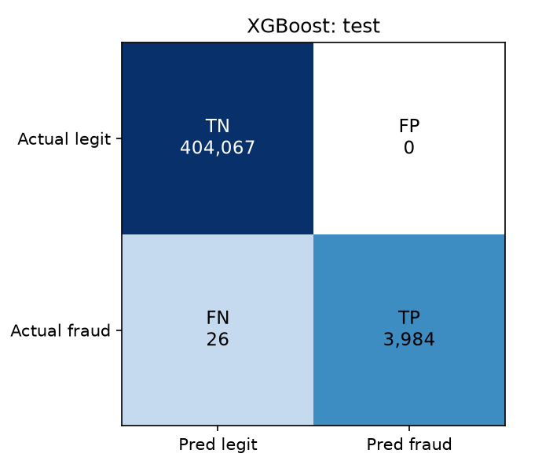 | 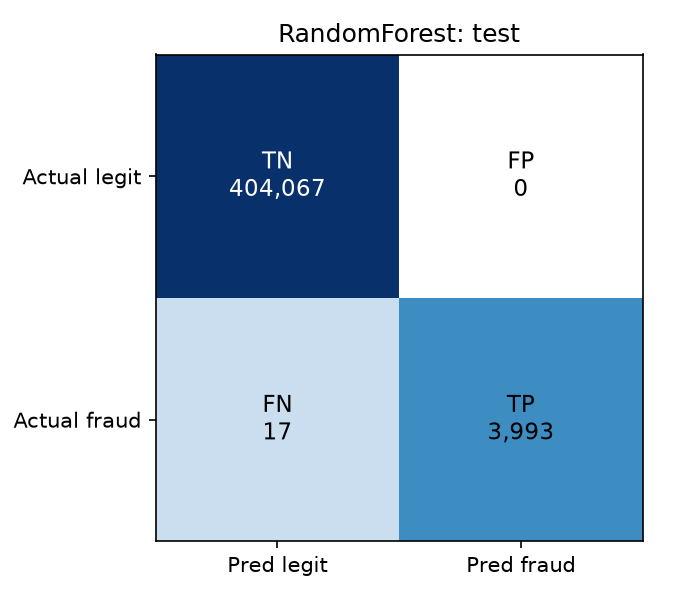 |
|  | |

*Figure 11. Test confusion matrices of the other models.*

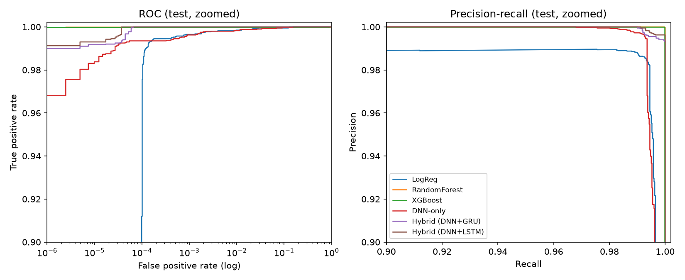
*Figure 12. ROC (log false-positive rate) and precision-recall curves on the test set, zoomed to the top-right.*

## 10. Discussion

1. **The hybrid improves on the plain DNN.** With the same tabular features, the hybrid GRU misses 30 frauds
   instead of 38. The LSTM variant also cuts false alarms from 11 to 2, raising precision to 0.9995.
2. **Tree ensembles are the strongest models on PaySim.** Random Forest catches 3,993 of 4,010 frauds with no
   false alarms. PaySim's fraud signal lives in sharp thresholds on balance columns (for example "amount
   equals the full balance"), which trees capture directly.
3. **Why all scores are so high.** The simulator's fraud behaviour (drain the account, then cash out) leaves
   a near-deterministic footprint in the balance columns, so the differences between models come down to a
   few dozen transactions out of 408,077.
4. **Why the recurrent branch helps little here.** Almost no account in PaySim has more than one transaction,
   so the history window usually holds only the current transaction. The fusion attention correctly learns
   to rely on the transaction branch (about 90% of the weight). The architecture is ready for data with
   real histories, where the recurrent branch would carry more information.
5. **Threshold behaviour under drift.** Thresholds tuned on a 0.14%-fraud validation period carried over well
   to a 0.98%-fraud test period: precision stayed above 0.997 for every deep model.

## 11. FraudGuard console (the product)

The model is delivered as **FraudGuard, a fraud-operations console** for analysts at a mobile-money provider.
Every transfer is scored and given one of three decisions: **BLOCK** (probability at or above the
validation-tuned threshold, 0.9989), **REVIEW** (0.50 up to the threshold, sent to an analyst) or
**APPROVE**. Decisions are always shown as text as well as colour (red, amber, green).

Run with `streamlit run app/streamlit_app.py`. The design follows a dark fintech style (navy background,
Fira Sans / Fira Code, SVG logo and Material icons, no emoji) and has six pages in two groups. Each page has
its own address: `/` (Overview), `/alerts`, `/investigate?txn=<id>`, `/live`, `/check?example=fraud` (loads
and scores a fixed test fraud) and `/model`. A status bar on every page shows the model, the block threshold,
the review band and the monitoring window.

| Page | What the analyst does there |
|---|---|
| **Overview** | Sees business outcomes: money protected, share of fraud caught, alerts, false alarms and fraud missed, with changes over the last 24 simulated hours; alerts against actual fraud per hour, with missed-fraud hours marked. |
| **Alert queue** | Works through every BLOCK and REVIEW transfer, filtered by decision, type, case status, amount and hours; selects one to open its case. |
| **Investigate** | Reviews one case: the decision, balances, plain-language "why flagged" signals, how much the model relied on the transaction versus the account history (attention weights), and the destination account's activity (possible mule account); then records **Confirm fraud**, **Mark legit**, **Escalate** or **Start investigating** with notes. |
| **Live monitor** | Replays the test period hour by hour as a live feed, with ticking counters, a growing chart, a feed of new blocks and a notification each time fraud is blocked; Start, Pause and Reset controls. |
| **Check transaction** | Scores one transfer like a payment-gateway call: a decision card, the scoring time in milliseconds, the signals, attention weights and the JSON response. |
| **Model & reports** | Chooses the threshold by business cost: set the cost of one false alarm and see the cost-optimal threshold and the trade-off between false alarms and missed fraud, computed on the **validation** period so the test set stays untouched. Also a model card, the test results table and every report figure. |

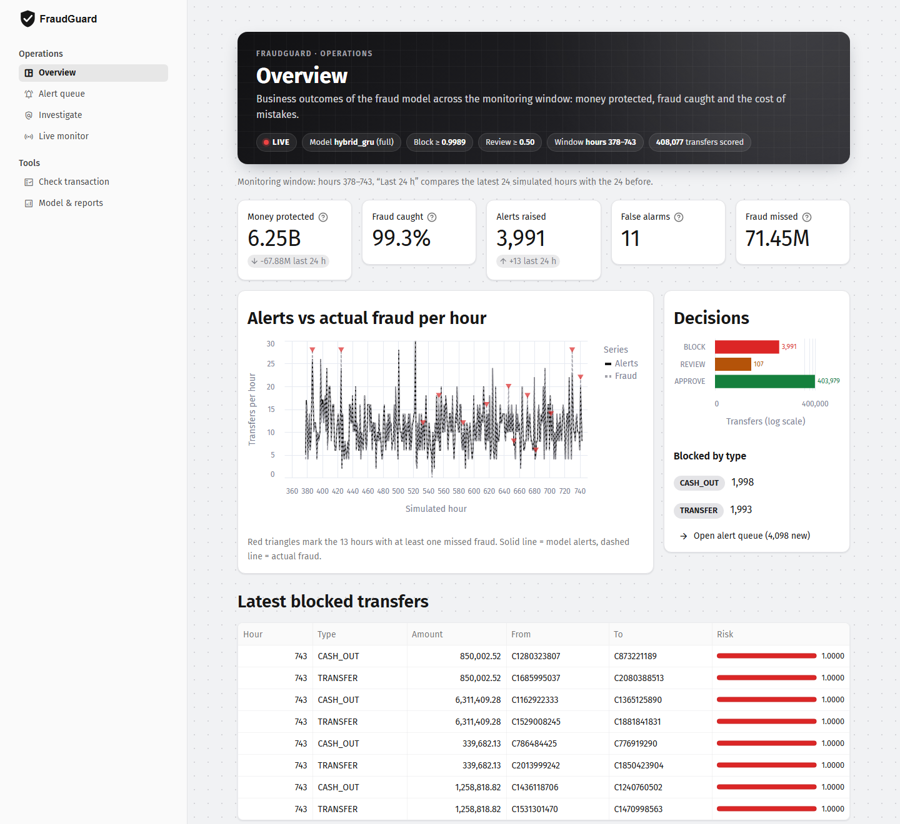
*Figure 13. Overview: 6.25B of fraud blocked over the test period, 99.3% of fraud caught, 11 false alarms.*

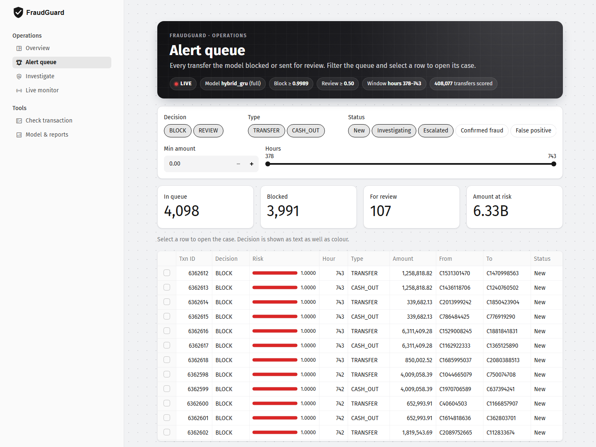
*Figure 14. Alert queue: 4,098 alerts (3,991 blocked, 107 for review), filterable, with case status.*

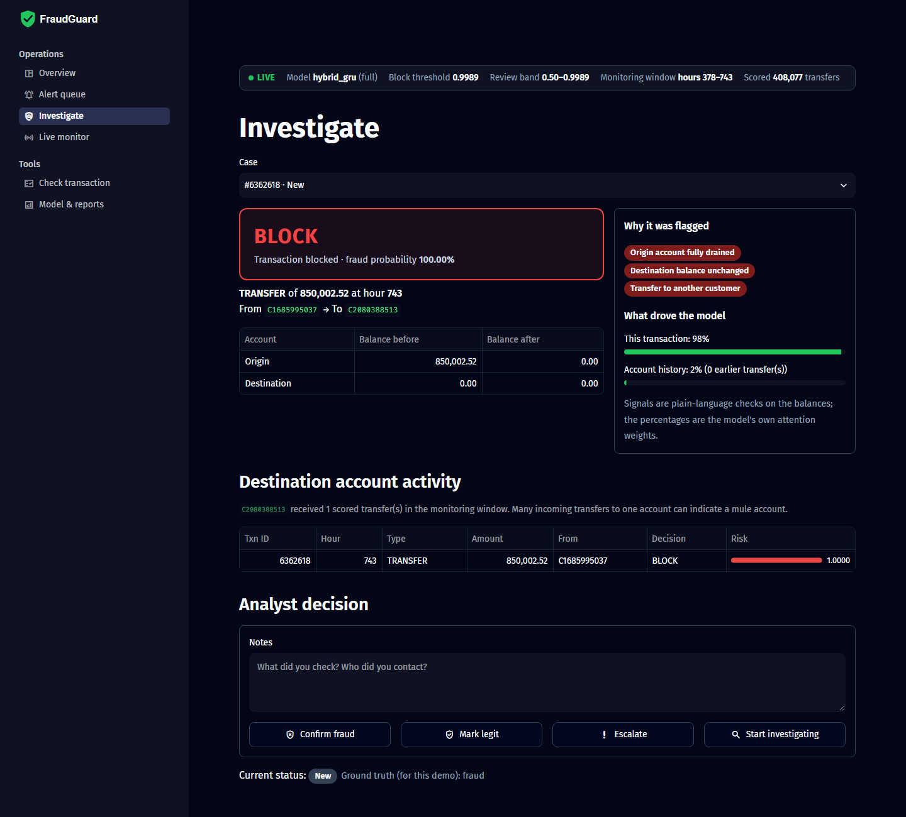
*Figure 15. Case investigation: a drained account sending its full balance to an untouched destination.
The model relied 98% on the transaction itself and 2% on account history.*

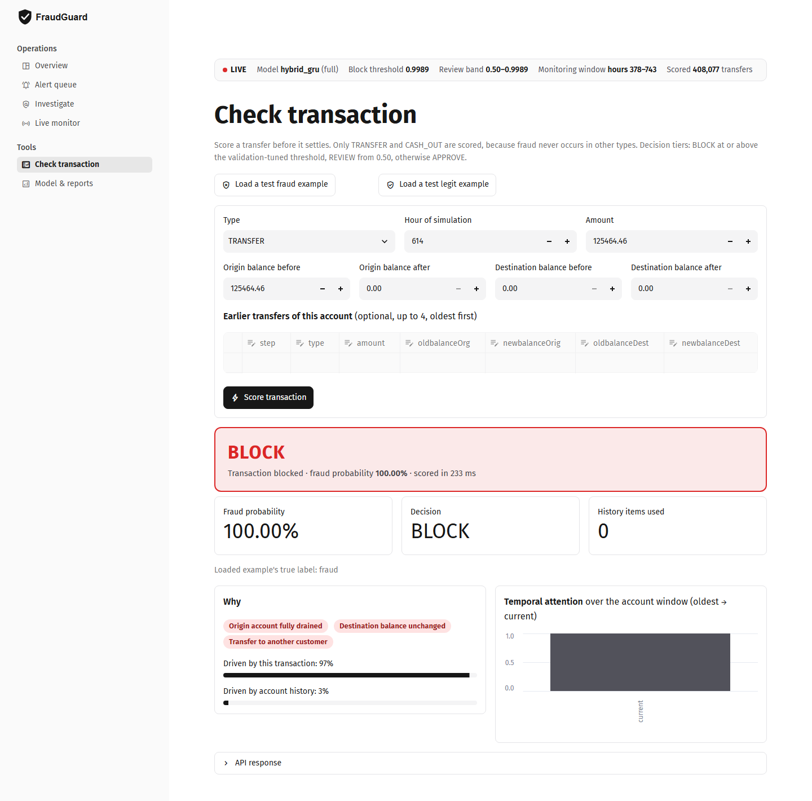
*Figure 16. Check transaction: a real test fraud scored at 100% and blocked in about 0.2 seconds.*

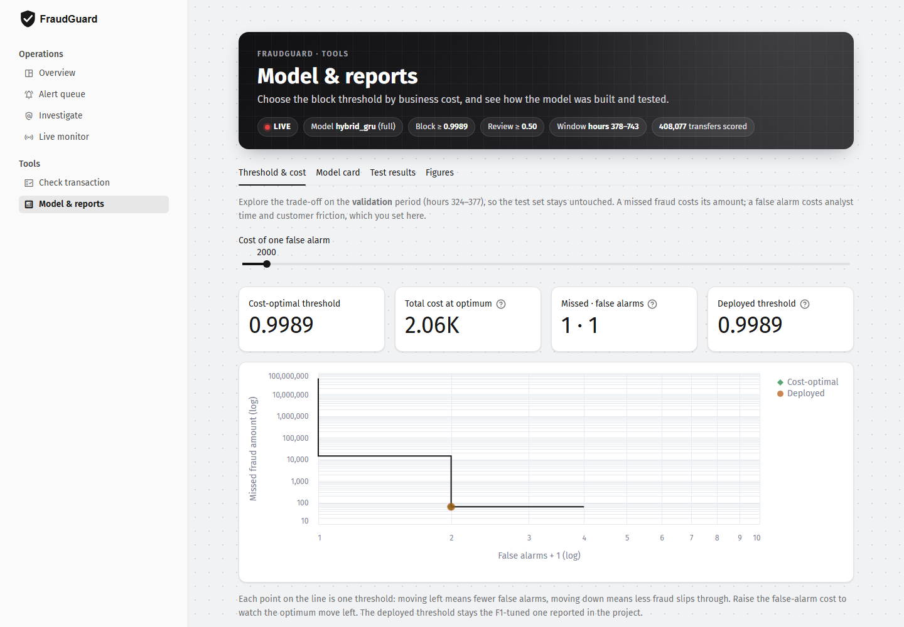
*Figure 17. Threshold and cost: at a false-alarm cost of 2,000 the cost-optimal threshold equals the deployed
F1-tuned threshold (one missed fraud, one false alarm on validation).*

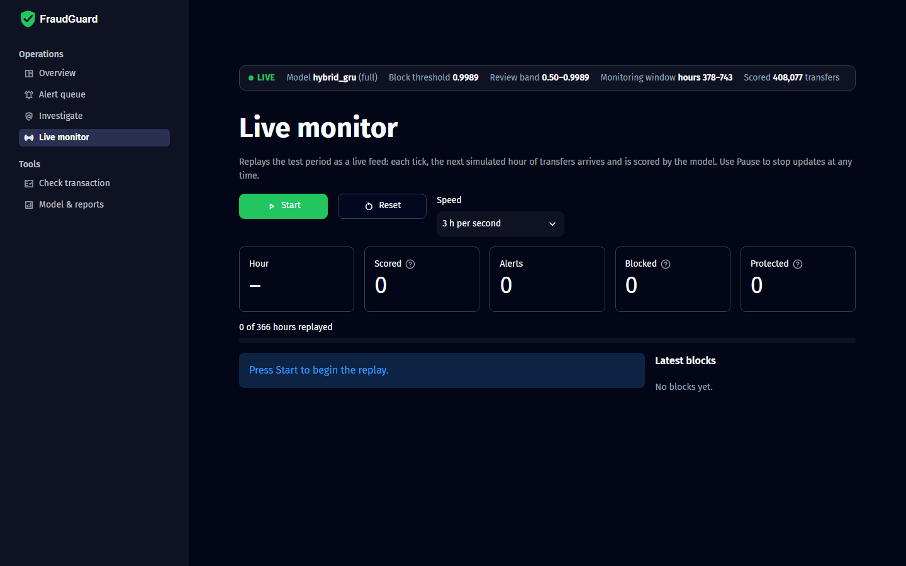
*Figure 18. Live monitor before the replay starts.*

Analyst decisions are kept for the browser session only; a real deployment would store them in a database
shared by all analysts.

## 12. Testing and quality checks

41 automated tests (pytest) cover every stage:

| Test file | What it guarantees |
|---|---|
| `test_data.py` | split is chronological, disjoint, on whole hours, ~70/15/15; dev sample keeps all fraud |
| `test_features.py` | exact feature values; label and `isFlaggedFraud` never used; scaler fit on train only |
| `test_sequences.py` | windows contain only past rows of the same account, never cross a split, pad and mask correctly |
| `test_metrics.py` | confusion matrix layout [[TN, FP], [FN, TP]], threshold selection, class weights |
| `test_models.py` | valid probabilities, padding cannot change output, attention sums to 1, save/load round-trip |
| `test_inference.py` | app scoring equals batch pipeline to 1e-5 |
| `test_app.py` | all six pages render without errors; scoring, analyst decisions and the live replay work; decision tiers, money metrics and risk signals are correct; the cost curve matches a direct calculation at every threshold and is never beaten by a fixed threshold |

Other checks: all arrays finite, train features standardized, every figure inspected by eye, the evaluation
dry-run on the development sample before the single full test run, and manual browser checks of the app.

## 13. Version control workflow

- One logical change per commit, following Conventional Commits (`feat:`, `test:`, `docs:`, `chore:`),
  with imperative subjects under 72 characters and a body that explains why.
- Each module and its tests are committed separately, in dependency order. We checked out every commit on its
  own and ran the test suite to confirm no commit is in a failing state.
- Data, trained models and generated figures are git-ignored; only code, tests and documentation are tracked.

## 14. Limitations and future work

- **Synthetic data.** PaySim's fraud pattern is cleaner than real fraud, so the scores overstate what a real
  deployment would reach.
- **Sparse histories.** Sequences per `nameOrig` are almost empty. Building windows on `nameDest` (destination
  accounts repeat heavily, and fraud money flows into mule accounts) or on a real dataset with account
  histories would let the recurrent branch contribute much more.
- **Harder evaluation.** A version without the balance-error features would test whether the models learn
  behaviour beyond the simulator's bookkeeping footprint.
- **Calibration and cost.** Choosing the threshold by business cost (a missed fraud versus a false alarm) instead
  of F1, and calibrating probabilities, would make the app's decisions more realistic.
- **GPU training** under WSL2 would allow larger models and hyperparameter search.

## 15. How to reproduce

```bash
python -m venv .venv
.venv/Scripts/pip install -r requirements.txt     # Linux/macOS: .venv/bin/pip
# place the PaySim CSV at data/raw/paysim.csv
python -m src.eda                 # Stage 1
python -m src.prepare             # Stage 2 (add --dev for the sample)
python -m src.baselines           # Stage 3
python -m src.train --rnn gru     # Stage 4
python -m src.train --rnn lstm
python -m src.evaluate            # Stage 5 (scores the test set once)
python docs/make_diagrams.py      # documentation diagrams and images
streamlit run app/streamlit_app.py
python -m pytest -q
```

Full run time on a 16-thread CPU: about 15 minutes in total.

## 16. References

1. E. A. Lopez-Rojas, A. Elmir, S. Axelsson. *PaySim: A financial mobile money simulator for fraud
   detection.* 28th European Modeling and Simulation Symposium (EMSS), 2016.
2. PaySim dataset, Kaggle: `ealaxi/paysim1`.
3. K. Cho et al. *Learning phrase representations using RNN encoder-decoder for statistical machine
   translation* (GRU). EMNLP, 2014.
4. S. Hochreiter, J. Schmidhuber. *Long short-term memory.* Neural Computation, 1997.
5. D. Bahdanau, K. Cho, Y. Bengio. *Neural machine translation by jointly learning to align and translate*
   (additive attention). ICLR, 2015.
6. T. Chen, C. Guestrin. *XGBoost: A scalable tree boosting system.* KDD, 2016.
7. L. Breiman. *Random forests.* Machine Learning, 2001.
